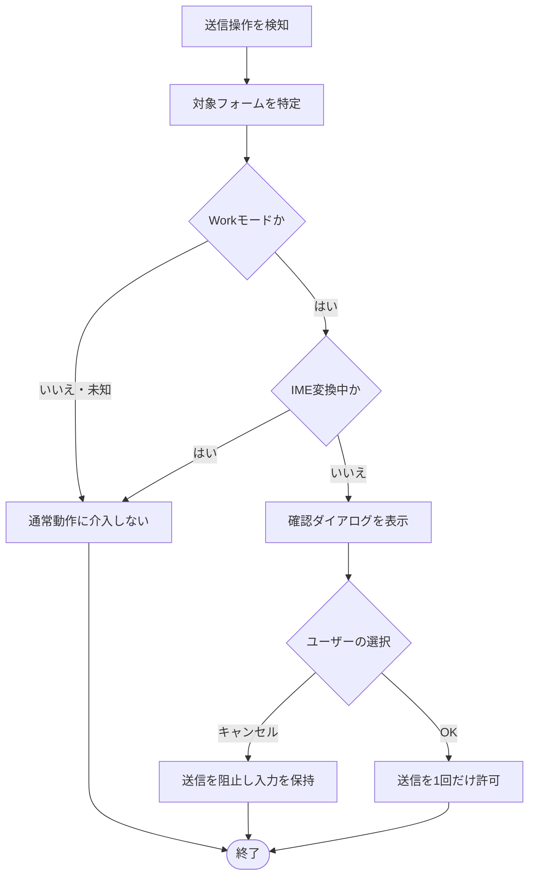
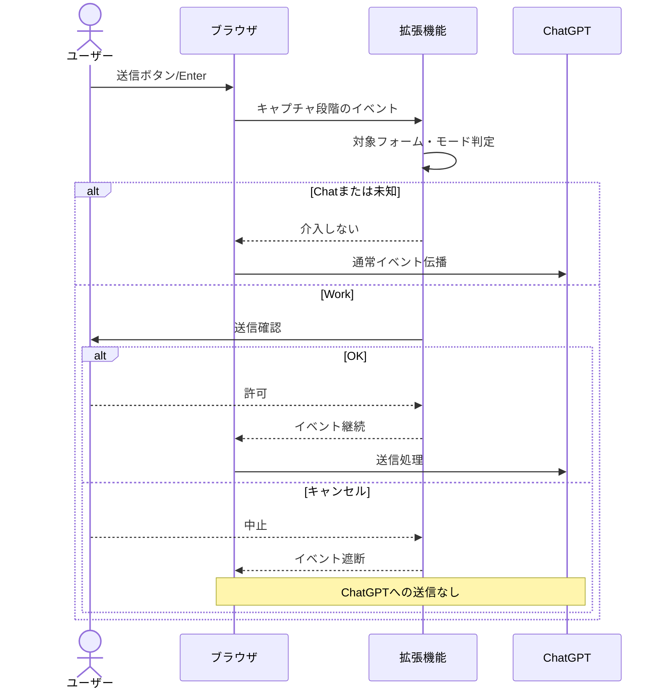

# ChatGPT Work送信確認拡張機能 設計書

> 元の `設計書.md` を移動した実装前設計書です。以下の版数・検証状態は作成時点の記述です。現在のファイル構成は[ファイルごとの説明](README.md)、実装後の確認状況は[検証記録](test-results.md)を参照してください。

- 文書版数：0.2（実装前）
- 対象：Google Chrome / Microsoft Edge（Chromium系）、Manifest V3
- 対象URL：`https://chatgpt.com/*`
- 状態：提供されたホーム画面のDOMを根拠とする設計案。実機での送信制御は未検証。

## 1. 目的とスコープ

ChatGPTのWorkモードでの意図しない送信を防ぐため、送信操作の直前に確認する。Chatモードには介入しない。

### 対象
- Workモードでの送信ボタンクリックとEnter送信
- OKで送信、キャンセルで中止
- Chat/Work切替、画面遷移後の継続動作
- 日本語IME変換中のEnterへの非介入

### 対象外（初版）
- ChatGPT以外のサイト
- メッセージ内容の保存、外部転送、解析
- 拡張機能の設定画面、履歴画面
- 音声入力、音声会話、ChatGPT内部APIの直接呼び出し

## 2. 構成

| 要素 | 役割 |
|---|---|
| `manifest.json` | MV3定義、`chatgpt.com`にContent Scriptを注入 |
| `content.js` | モード判定、送信操作の捕捉、確認とキャンセル |
| `README.md` | インストール方法、検証手順、制限事項 |
| `tests/` | DOM模擬テスト、可能ならPlaywrightによるE2E |

初版ではBackground Service Worker、外部API、ストレージ権限を使用しない。最小権限を基本とする。

## 3. 機能要件

| ID | 機能 | 要件 |
|---|---|---|
| F-01 | モード判定 | 送信操作時に対象フォームのChat/Workを判定する |
| F-02 | ボタン送信 | Workの送信ボタン操作で確認を表示する |
| F-03 | Enter送信 | WorkのEnter送信で確認を表示する |
| F-04 | 送信許可 | OK時に送信を1回だけ成立させる |
| F-05 | 送信中止 | キャンセル時に送信を発生させず入力内容を保持する |
| F-06 | Chat除外 | Chatでは通常動作に干渉しない |
| F-07 | IME対応 | 変換確定中のEnterを送信として扱わない |
| F-08 | 動的DOM | モード切替やSPA遷移後も検知する |
| F-09 | 多重防止 | 同一操作で確認を重複表示しない |
| F-10 | 安全側動作 | Workと確認できたのに送信阻止が不確実な場合、成功扱いしない |

## 4. DOM判定仕様

提供されたChat/Work両モードの**ホーム画面・入力あり**のHTMLで確認された属性を採用する。

| 項目 | Chat | Work |
|---|---|---|
| 入力欄 | `[data-composer-markdown][aria-label="ChatGPT に聞く"]` | `[data-composer-markdown][aria-label="Work モードで作成"]` |
| 入力欄コンテナ | `[data-composer-input-variant="default"]` | `[data-composer-input-variant="work-home"]` |
| 送信ボタン | `button[type="submit"][aria-label="送信"]` | 同左 |
| フォーム | `form[data-chatgpt-composer]` | `form[data-thread-find-composer="true"]`（ホーム画面で確認） |

**注意：** `form[data-chatgpt-composer]` はWork側の提供HTMLには存在しない。共通フォームの検出にこの属性だけを使わない。また、`data-composer-mode="work"` は提案ボタンにも現れるため、現在のモード判定には使わない。

### 判定アルゴリズム
1. イベント発生元から直近の `form` を特定する（Enterの場合は対象の編集欄から）。
2. **同一フォーム内**でWork入力欄ラベルまたは `work-home` コンテナを探す。
3. Workと確認できれば確認対象とする。
4. Chat入力欄ラベルが確認できれば介入しない。
5. いずれにも該当しない場合は**未知モード**とする。初版は未知モードへの介入を行わず、READMEに保護対象外として明記する。未知モードがWorkである可能性は実機テストで調べる。

言語設定によって `aria-label` が変化し得るため、`work-home` を優先的な構造手掛かりとし、属性変更への耐性を検証する。ハッシュ付きCSSクラス名や動的IDには依存しない。

## 5. 処理フロー

### イベント処理方針
- クリック：`document`のキャプチャフェーズで対象送信ボタンを検知する。
- キー入力：`document`のキャプチャフェーズで、対象編集欄のEnterを検知する。`Shift+Enter`等の改行操作には介入しない。
- フォーム送信：`submit`を補助的な検知経路として扱う。ただしReactが独自に処理する場合は`submit`だけでは不十分。
- IME：`event.isComposing`、`compositionstart/end`、必要に応じて`keyCode === 229`を考慮する。
- キャンセル：React側の送信処理に到達する前に`preventDefault()`、`stopImmediatePropagation()`等で遮断する。イベント種別・登録順序により阻止できるかは実機確認が必要。
- OK：**原イベントを止めずに継続**できる経路を優先する。非同期の独自ダイアログを採用する場合は、原イベントを止めた後の再送制御が必要となるため、初版は同期的な`window.confirm()`を第一候補とする。
- `window.confirm()`はブラウザの表示制限やフォーカス状態の影響を受け得る。ダイアログが抑制された場合の挙動をテストする。
- 同一操作が`click`と`submit`の両方で検知される場合の重複を防ぐ。実装方式に応じてイベント単位の許可状態を管理する。

## 6. 送信イベントのシーケンス

## 7. 非機能要件

- 送信テキストを拡張機能側に保存・送信しない。
- 不要な権限を要求しない。対象ホストを`chatgpt.com`に限定する。
- 画面上の全DOMを継続的に走査しない。イベント時に必要な範囲を照会する。
- 通常のChat送信、改行、IME変換、音声機能を妨げない。
- ChatGPT側のDOM変更で動作不能となる可能性をREADMEに明記する。

## 8. テスト計画

| ID | 条件・操作 | 期待結果 |
|---|---|---|
| T-01 | Chatで送信ボタンクリック | 確認なしで送信 |
| T-02 | ChatでEnter | 確認なしで送信 |
| T-03 | Workで送信ボタン→キャンセル | 送信なし、入力保持 |
| T-04 | Workで送信ボタン→OK | 1回だけ送信 |
| T-05 | WorkでEnter→キャンセル | 送信なし、入力保持 |
| T-06 | WorkでEnter→OK | 1回だけ送信 |
| T-07 | 日本語IME変換確定 | 確認なし、送信なし |
| T-08 | Shift+Enterで改行 | 確認なし、改行 |
| T-09 | Chat⇄Work切替 | 切替後のモードで判定 |
| T-10 | ページ再読み込み・SPA遷移 | 継続動作 |
| T-11 | 送信を連続操作 | 二重確認・二重送信なし |
| T-12 | 会話画面でWork送信 | ホーム画面と同等（要追加DOM確認） |
| T-13 | 未知DOM・他言語UI | 想定外の送信防止保証はしない、誤判定を記録 |
| T-14 | ダイアログ抑制時 | 意図しないWork送信が起きないか検証 |

テストは(1)DOM模擬ユニットテスト、(2)拡張機能を読み込んだChromiumの自動テスト、(3)ログイン済みChatGPTでの手動確認の順に実施する。実送信を伴うT-04/T-06等はユーザーの許可後に実施する。

## 9. Codexによる実装・検証手順

1. この設計書と提供HTMLをリポジトリに配置する。
2. Codexに拡張機能・テスト・READMEを実装させる。
3. DOM模擬テストを実行し、失敗を修正させる。
4. PlaywrightのChromium永続コンテキストなど、拡張機能を読み込める環境を用意する。
5. ChatGPTへのログインはユーザーが行う。認証情報をCodexに渡さない。
6. キャンセル系を優先して実サイトで検証する。
7. 実送信テストはユーザーの許可後に実施する。
8. テスト結果を「成功／失敗／未実施」に分けて記録する。

## 10. 未確定事項とリスク

| 項目 | 現状 | 対応 |
|---|---|---|
| Work会話画面のDOM | 未取得 | 実機で追加確認 |
| Reactイベントの登録順序 | 未確認 | キャンセル時の送信阻止をE2E検証 |
| Enter送信の内部実装 | 未確認 | Enter/Shift+Enter/IMEを実機検証 |
| `confirm()`の抑制挙動 | 未確認 | 抑制条件と代替UIを検討 |
| ChatGPTのUI変更 | 継続的リスク | セレクタ集中管理、テスト保守 |

## 11. 完了条件

- T-01〜T-11が対象環境で成功する。
- Workのキャンセルでメッセージが送信されないことを実機で確認する。
- OK時に送信が1回だけ発生することを実機で確認する。
- 未実施項目と保護できない画面・条件がREADMEに明記されている。

---

本設計書は提供HTMLを基にした実装前仕様であり、実機確認で判明した挙動に合わせて更新する。
